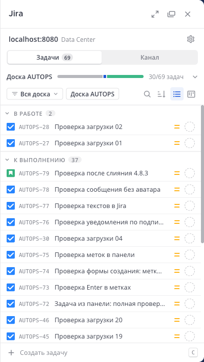
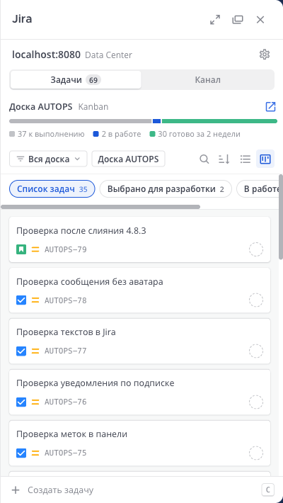
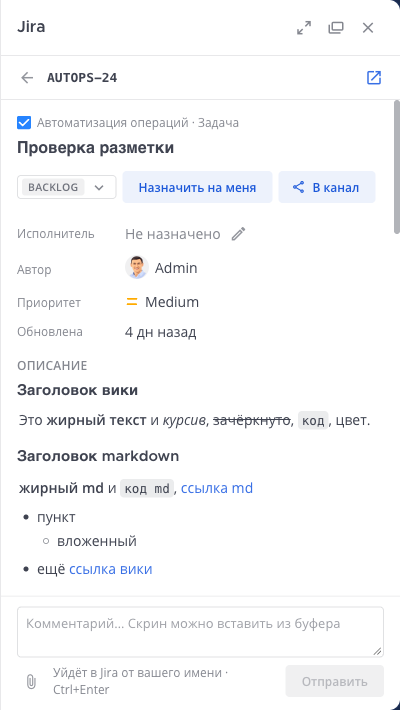
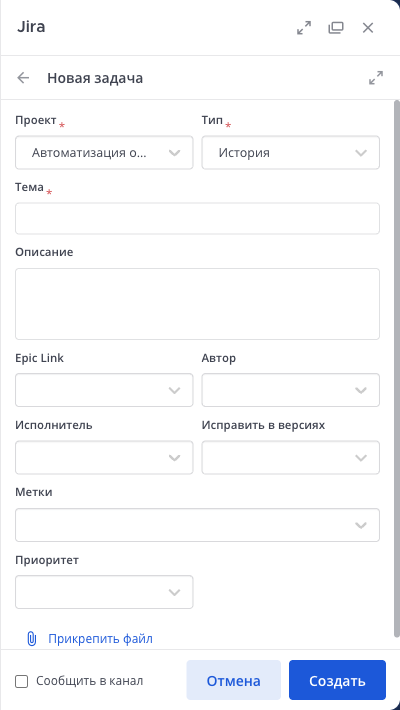
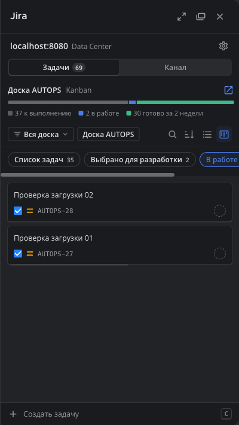

# Jira для Mattermost — версия с боковой панелью

[](https://github.com/moonssword/mattermost-plugin-jira/actions/workflows/ci.yml)
[](https://github.com/moonssword/mattermost-plugin-jira/releases)
[](LICENSE.txt)

[English version](readme.md)

Форк официального [плагина Jira для Mattermost](https://github.com/mattermost/mattermost-plugin-jira), который переносит работу с Jira в правую боковую панель Mattermost. Задачи можно находить, читать, создавать и двигать по статусам, комментировать, прикладывать файлы и управлять подписками канала, не уходя из Mattermost. Команды `/jira` и прежние окна остаются запасным вариантом.

Форк рассчитан на **Jira Data Center** и **русскоязычную** команду, английский интерфейс тоже есть. Всё, что умеет исходный плагин, продолжает работать: это исходная версия 4.8.3 плюс панель.

| Мои задачи | Доска | Карточка | Новая задача | Тёмная тема |
|---|---|---|---|---|
|  |  |  |  |  |

## Возможности

**Мои задачи**
- Быстрые фильтры: назначены мне, я автор, слежу, текущий спринт; при выбранной доске — вся доска.
- Поиск по ключу, по тексту и по JQL. Если Jira отклоняет JQL, показывается её собственная ошибка.
- Список с группами по категории статуса или доска с колонками самой доски.
- Счётчики групп и колонок приходят сразу; задачи загружаются при раскрытии группы или открытии колонки, дальше — при прокрутке.
- Выбор доски с прогрессом активного спринта или Kanban-доски с учётом фильтра доски и дополнительного фильтра Kanban.

**Карточка задачи**
- Поля, описание и комментарии с разметкой Jira, Confluence, Markdown и Яндекса.
- Смена статуса, в том числе переходы со своим экраном полей в Jira; исполнитель; комментарии с файлами и вставленными скриншотами.
- Вложения плитками, открываются в просмотрщике Mattermost.
- «В канал» и «Открыть в Jira».

**Создание и вложения**
- Форма создания в панели с полями проекта и файлами; прежнее окно доступно в один клик.
- «Приложить к задаче» из меню сообщения; ссылка уходит в тред.

**Канал**
- Подписки канала в панели: создание, изменение, пауза, удаление. Прежнее окно подписок тоже доступно.

**Везде**
- Живые обновления по вебхуку Jira: список и открытая карточка обновляются сами.
- Русский и английский: панель, страница плагина в System Console, сообщения бота, ответы `/jira` и тексты, которые плагин пишет в Jira. Язык панели каждый выбирает сам; сообщения в каналах — на языке интерфейса сервера по умолчанию.
- Компактный стиль и карточки, светлая и тёмная тема по теме Mattermost.
- Режим разработки: плагин целиком доступен только перечисленным пользователям, пока его пробуют.
- На странице плагина в System Console — инстансы Jira, адрес вебхука, мастер настройки и число подключённых пользователей.

## Совместимость

| | |
|---|---|
| Mattermost | 10.7 и новее (проверено на 11.10) |
| Jira | Data Center / Server (проверено на 10.7.3) |
| Jira Cloud | Работает как в исходном плагине; панель сделана и проверена для Data Center |
| Браузеры | Актуальные Chrome, Edge, Firefox и Safari |

Исходная ветка 5.x требует Mattermost 12, поэтому форк следует линии 4.8, пока сервер не обновлён.

## Установка

> [!IMPORTANT]
> Идентификатор плагина — `jira`, как у официального, поэтому форк **заменяет** его. Инстансы, подключения пользователей и подписки сохраняются. Не ставьте оба сразу и не соглашайтесь на «обновление» до официальной сборки в Marketplace.

1. Скачайте `jira-<версия>.tar.gz` и `.sha256` со страницы [Releases](https://github.com/moonssword/mattermost-plugin-jira/releases) и проверьте контрольную сумму:
   ```bash
   shasum -a 256 -c jira-<версия>.tar.gz.sha256
   ```
2. **System Console → Плагины → Управление плагинами → Загрузить плагин**, затем включите его.
3. Если Jira раньше не была подключена, установите инстанс командой `/jira setup` или `/jira instance install server <адрес Jira>` и пройдите шаги: [инструкция исходного плагина](https://docs.mattermost.com/integrations-guide/jira.html).
4. Включите **«Показывать задачи Jira в правой боковой панели»** (ниже). Пользователи подключают свой аккаунт Jira прямо из панели.

## Настройка

**System Console → Плагины → Jira**. Страница на языке администратора.

| Настройка | По умолчанию | |
|---|---|---|
| Показывать задачи Jira в правой боковой панели | выкл. | Включает панель. |
| Режим разработки / Пользователи режима разработки | выкл. / пусто | Во включённом режиме плагин работает только для перечисленных логинов Mattermost. В выключенном список не учитывается. |
| Стиль правой панели по умолчанию | Компактный | Пользователи могут выбрать свой. |
| API-токен администратора | — | Необязательно. Для Data Center — персональный токен доступа администратора Jira: уведомления о событиях пользователей, не подключивших Jira, и автоссылки. |

Остальные настройки — из исходного плагина, они описаны в [его документации](https://docs.mattermost.com/integrations-guide/jira.html).

Для живых обновлений оставьте вебхук Jira, созданный при настройке (его адрес — на странице плагина). Если Mattermost или Jira стоят за обратным прокси, прокси должен передавать Jira схему и хост (`X-Forwarded-Proto` или `scheme`/`proxyName` в `server.xml` Jira), иначе «Связать приложения» не сработает.

Картинки в старых сообщениях бота загружаются прямо из Jira; чтобы и они не шли из браузера во внутреннюю сеть, включите **прокси изображений** в Mattermost.

## Безопасность

- Все запросы в Jira делает сервер плагина с OAuth-токеном самого пользователя. Токены не попадают в браузер, и браузер не обращается к Jira: иконки, аватары и вложения отдаёт плагин.
- Вложение отдаётся, только если токен пользователя читает задачу, к которой оно относится. Прямо в браузере открываются только растровые изображения; остальное скачивается, с запрещающей политикой Content-Security-Policy.
- Маршрут иконок читает только пути иконок и аватаров Jira.
- Сведения об инстансах и вебхуке доступны только системным администраторам.

Об уязвимостях сообщайте закрыто, как описано в [SECURITY.md](SECURITY.md).

## Отличия от исходного плагина

- Добавлено: боковая панель и всё перечисленное выше; русский перевод; режим разработки; счётчик пользователей; картинки Jira через сервер плагина.
- Изменено: форма создания не пишет в канал, пока об этом не попросят; в сообщениях бота нет аватара; сообщения в каналах и тексты в Jira — на языке интерфейса сервера по умолчанию.
- Сохранено: все команды, окна, подписки, вебхуки и настройки исходной версии 4.8.3.

Подробности — в [CHANGELOG.md](CHANGELOG.md).

## Разработка

```bash
make check-style   # golangci-lint и eslint
make test          # тесты Go и Jest
make dist          # dist/jira-<версия>.tar.gz
```

Локальный Mattermost и Jira, сборка для прода и слияние с исходным плагином описаны в [docs/DEVELOPMENT.md](docs/DEVELOPMENT.md).

Ветки: `main` — этот форк, `master` — копия исходного плагина. Pull request'ы — в `main`; CI запускает линтеры и тесты на каждый push и pull request.

## Версии и релизы

Версии имеют вид `<версия исходного плагина>-rhs.<n>`, например `4.8.3-rhs.1`: исходный релиз, на котором построен форк, и собственный счётчик форка. Тег `v*` на `main` собирает бандл и публикует его с SHA-256 на странице [Releases](https://github.com/moonssword/mattermost-plugin-jira/releases).

## Поддержка

Вопросы и ошибки панели — в [issues этого репозитория](https://github.com/moonssword/mattermost-plugin-jira/issues). То, что воспроизводится и в официальном плагине, лучше сообщать [в исходный репозиторий](https://github.com/mattermost/mattermost-plugin-jira/issues).

## Лицензия

Apache 2.0, см. [LICENSE.txt](LICENSE.txt), кроме `server/enterprise` — он под [Mattermost Source Available License](LICENSE.enterprise), как в исходном плагине, и здесь не менялся.

Это независимый форк, не связанный с Mattermost, Inc. и Atlassian и не одобренный ими. Mattermost и Jira — товарные знаки их владельцев.
