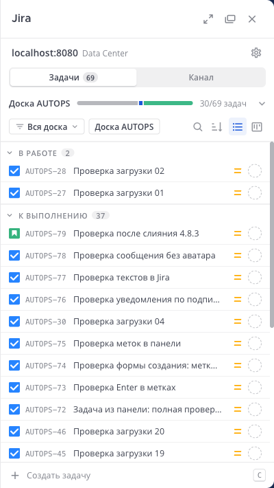
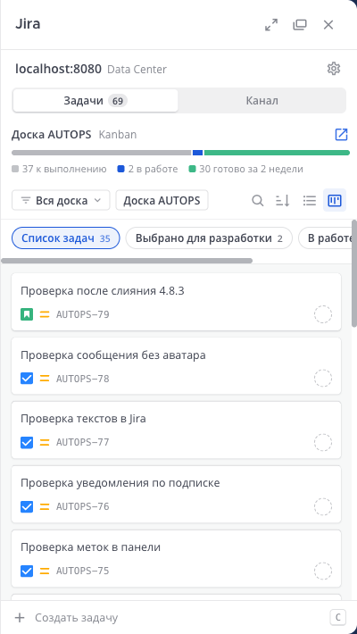
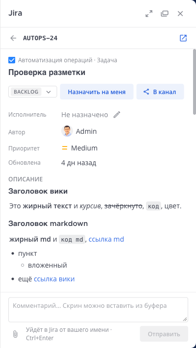
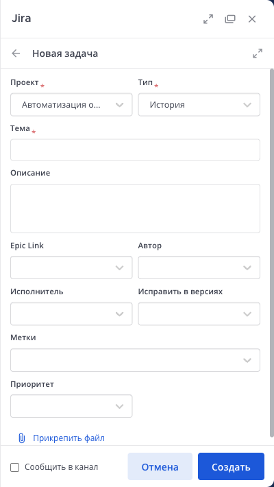
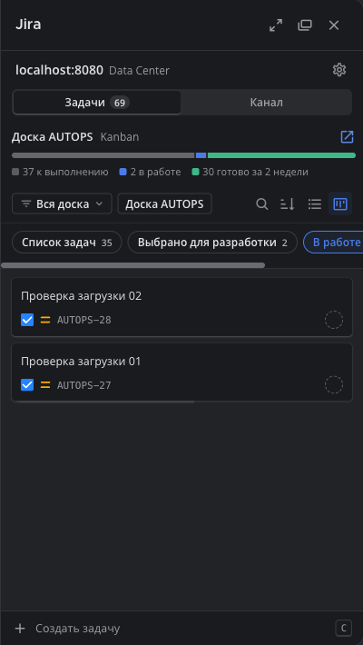

# Jira for Mattermost — sidebar edition

[](https://github.com/moonssword/mattermost-plugin-jira/actions/workflows/ci.yml)
[](https://github.com/moonssword/mattermost-plugin-jira/releases)
[](LICENSE.txt)

[Русская версия](README.ru.md)

A fork of the official [Mattermost Jira plugin](https://github.com/mattermost/mattermost-plugin-jira) that brings Jira into the Mattermost right-hand sidebar. Users find, read, create and move issues, comment, attach files and manage channel subscriptions without leaving Mattermost. Slash commands and the original dialogs keep working as a fallback.

The fork targets **Jira Data Center** and a **Russian-speaking** team, with English throughout as well. Everything the upstream plugin does still works: this is upstream 4.8.3 plus the sidebar.

| My issues | Board | Issue card | New issue | Dark theme |
|---|---|---|---|---|
|  |  |  |  |  |

## Contents

- [Features](#features)
- [Compatibility](#compatibility)
- [Installation](#installation)
- [Configuration](#configuration)
- [Security and privacy](#security-and-privacy)
- [Differences from upstream](#differences-from-upstream)
- [Development](#development)
- [Versioning and releases](#versioning-and-releases)
- [Support](#support)
- [License](#license)

## Features

**My issues**
- Quick filters: assigned to me, reported by me, watching, current sprint; with a board chosen, the whole board.
- Search by issue key, by text or with JQL. Jira's own error is shown for a JQL it rejects.
- A list grouped by status category, or a board with the board's own columns.
- Counters of every group and column come first; issues load when a group is unfolded or a column is opened, then page by page on scroll.
- Board picker with the active sprint or Kanban progress, honouring the board's filter and Kanban sub-filter.

**Issue card**
- Fields, description and comments with Jira wiki, Confluence, Markdown and Yandex markup.
- Status changes, including transitions with a Jira screen of their own, assignee, comments with files and pasted screenshots.
- Attachments as tiles, opened in the Mattermost file viewer.
- Share to the channel, open in Jira.

**Create and attach**
- A create form in the panel with the project's fields and files; the original dialog stays one click away.
- Attach a message to an issue from the message menu; a link goes to the thread.

**Channel**
- Channel subscriptions in the panel: create, edit, pause, delete. The original subscription dialog stays available.

**Everywhere**
- Live updates from the Jira webhook: the list and the open card refresh by themselves.
- Russian and English for the panel, the System Console page, bot messages, `/jira` replies and the texts the plugin writes into Jira. Each user chooses the language of the panel; channel posts follow the default interface language of the server.
- Compact and card styles, light and dark themes from the Mattermost theme.
- A development mode that limits the whole plugin to listed users while it is tried out.
- The System Console page shows the Jira instances, the webhook URL, the setup wizard and how many users connected Jira.

## Compatibility

| | |
|---|---|
| Mattermost | 10.7 or later (tested with 11.10) |
| Jira | Data Center / Server (tested with 10.7.3) |
| Jira Cloud | Works as in upstream; the sidebar is built and tested for Data Center |
| Browsers | Current Chrome, Edge, Firefox and Safari |

Upstream 5.x needs Mattermost 12; this fork follows the 4.8 line until the server is upgraded.

## Installation

> [!IMPORTANT]
> The plugin id is `jira`, the same as the official plugin, so the fork **replaces** it. Instances, user connections and subscriptions stay as they are. Do not install both, and do not let Marketplace "update" it to the official build.

1. Download `jira-<version>.tar.gz` and its `.sha256` from [Releases](https://github.com/moonssword/mattermost-plugin-jira/releases) and check the checksum:
   ```bash
   shasum -a 256 -c jira-<version>.tar.gz.sha256
   ```
2. **System Console → Plugins → Plugin Management → Upload Plugin**, then enable it.
3. If Jira was not connected before, install the instance with `/jira setup` or `/jira instance install server <Jira URL>` and follow the steps: [upstream setup guide](https://docs.mattermost.com/integrations-guide/jira.html).
4. Turn on **Show Jira tickets in the right-hand sidebar** (below). Users connect their Jira account from the panel.

## Configuration

**System Console → Plugins → Jira**. The page follows the language of the administrator.

| Setting | Default | |
|---|---|---|
| Show Jira tickets in the right-hand sidebar | off | Turns the panel on. |
| Development mode / Development mode users | off / empty | With the mode on, the plugin works only for the listed Mattermost logins. With it off, the list is ignored. |
| Default style of the right-hand sidebar | Compact | Users can choose their own. |
| Admin API Token | — | Optional. For Data Center, a Personal Access Token of a Jira administrator: notifications for events by users who did not connect Jira, and autolinks. |

The other settings are the upstream ones and are described in the [upstream documentation](https://docs.mattermost.com/integrations-guide/jira.html).

For live updates, keep the Jira webhook from the setup (its URL is on the plugin page). If Mattermost or Jira sit behind a reverse proxy, the proxy must pass the scheme and host to Jira (`X-Forwarded-Proto`, or `scheme`/`proxyName` in Jira's `server.xml`), otherwise the Application Link fails.

Pictures in older bot posts come straight from Jira; to keep the browser away from the company network for those too, enable **Image Proxy** in Mattermost.

## Security and privacy

- Every Jira request is made by the plugin server with the user's own OAuth token. Tokens never reach the browser, and the browser never talks to Jira: icons, avatars and attachments are served by the plugin.
- An attachment is served only after the user's token reads the issue it belongs to. Only raster images open inline; anything else is downloaded, under a sandboxing Content-Security-Policy.
- The icon route reads only Jira's icon and avatar paths.
- Instance and webhook details are for system administrators only.

Report vulnerabilities privately as described in [SECURITY.md](SECURITY.md).

## Differences from upstream

- Added: the right-hand sidebar and everything above; Russian translation; development mode; users count; Jira pictures through the plugin server.
- Changed: the create form does not post to the channel unless asked; bot posts have no avatar; channel posts and texts written into Jira follow the default interface language.
- Kept: all slash commands, dialogs, subscriptions, webhooks and settings of upstream 4.8.3.

The details are in [CHANGELOG.md](CHANGELOG.md).

## Development

```bash
make check-style   # golangci-lint and eslint
make test          # Go tests and Jest
make dist          # dist/jira-<version>.tar.gz
```

[docs/DEVELOPMENT.md](docs/DEVELOPMENT.md) covers a local Mattermost and Jira, production bundles and merging upstream.

Branches: `main` is this fork, `master` mirrors upstream. Pull requests go to `main`; CI runs the linters and tests on every push and pull request.

## Versioning and releases

Versions are `<upstream version>-rhs.<n>`, for example `4.8.3-rhs.1`: the upstream release the fork is built on, and the fork's own counter. A tag `v*` on `main` builds the bundle and publishes it with its SHA-256 on the [Releases](https://github.com/moonssword/mattermost-plugin-jira/releases) page.

## Support

Questions and bugs of the sidebar: [issues of this repository](https://github.com/moonssword/mattermost-plugin-jira/issues). Problems that also happen with the official plugin are best reported [upstream](https://github.com/mattermost/mattermost-plugin-jira/issues).

## License

Apache 2.0, see [LICENSE.txt](LICENSE.txt), except `server/enterprise`, which is under the [Mattermost Source Available License](LICENSE.enterprise) as in upstream and is not changed here.

This is an independent fork. It is not affiliated with or endorsed by Mattermost, Inc. or Atlassian. Mattermost and Jira are trademarks of their owners.
